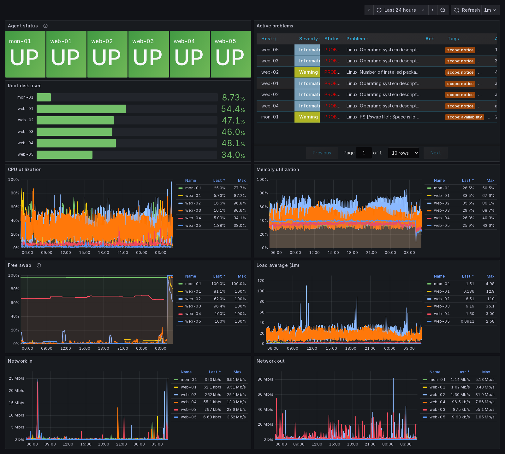
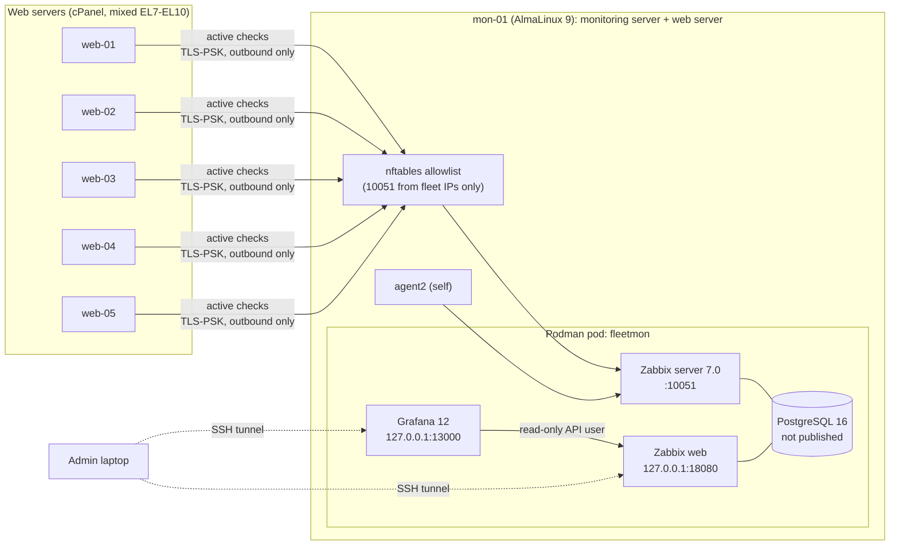
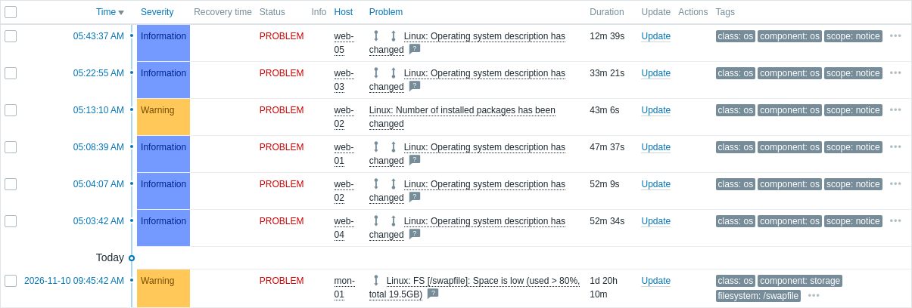
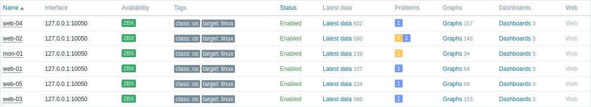

# Fleet Monitoring: Zabbix 7.0 + Grafana for a production hosting fleet

Production monitoring for a **fleet of 6 Linux web servers** (cPanel, about 1,000 hosted websites). It's built with **Zabbix 7.0 LTS**, **PostgreSQL** and **Grafana**, all in a single **Podman** pod, with encrypted active agents and no public exposure.

Designed and rolled out on a live production fleet in November 2026. Every server has reported continuously since.


<sub>Grafana "Fleet Overview" over the last 24 hours: agent status, root disk, active problems, CPU, memory, swap, load and network for all 6 servers. Server names are anonymized.</sub>

---

## At a glance

| | |
|---|---|
| **Monitored servers** | 6 production servers, a mixed fleet: AlmaLinux 8, 9, 10 and CloudLinux 7, 9 |
| **Stack** | Zabbix 7.0 LTS server + web, PostgreSQL 16, Grafana 12 with the Zabbix plugin, Podman |
| **Agents** | Zabbix agent2 (EL8+) or classic agent (EL7), **active mode**, **TLS-PSK encrypted** |
| **Onboarding** | Auto-registration: a new server joins the "Fleet" group with the Linux template, no clicking needed |
| **Exposure** | None. The UIs listen on `127.0.0.1` only, behind an SSH tunnel. Port 10051 is allowlisted per agent IP |
| **Footprint (measured)** | Agent ~18–36 MB RAM and ~0.2% CPU per server. The whole monitoring stack uses ~0.7 GB RAM |

## Architecture



## Security design

- **No inbound ports on the monitored servers.** The agents run in *active* mode: they connect **out** to the server. Each agent listens only on `127.0.0.1`.
- **Encrypted transport.** Agent↔server traffic uses **TLS-PSK**. Auto-registration accepts PSK only, so unencrypted agents are refused.
- **Nothing public.** The Zabbix UI and Grafana bind to `127.0.0.1` and are reached through an SSH tunnel. PostgreSQL isn't published at all.
- **Allowlisted trapper port.** Port 10051 accepts only the fleet's IPs. It's enforced in **nftables at the prerouting hook**, see *Problems found* below.
- **Least privilege.** Grafana reads Zabbix through a **read-only API user** scoped to the Fleet group. A separate **read-only viewer** account exists for teammates and screenshots, and its write access was tested and blocked.
- **No secrets in this repo or on screen.** Passwords and the PSK are generated on the server (`/opt/fleet-monitoring`, mode 600). The PSK is never printed, and a rotation step is built in (`configure-zabbix.sh`).

## Problems found and fixed during rollout

| Problem | How it was found | Fix |
|---|---|---|
| **Container ports bypass firewalld.** Podman's NAT (netavark) skips firewalld zone rules, so the published port 10051 was reachable from any IP | Rollout verification: **tested the port from an outside, non-allowlisted host** instead of trusting the config | Filter 10051 in a dedicated **nftables table at prerouting (before NAT)**, persisted with a systemd unit (`firewall-lock.sh`). Re-tested from outside: closed |
| **CSF egress filtering** on the older (EL7) servers blocked the agents' outbound 10051 | Agent log `connection error (POLLERR)`, then a manual TCP test | The agent installer adds 10051 to CSF `TCP_OUT` (with a backup) and checks reachability before finishing |
| **Mixed OS versions.** EL7 has `yum` and no agent2 package | The first install on CloudLinux 7 failed | The installer detects EL7/8/9/10 and picks `dnf` or `yum` and agent2 or the classic agent. Tested on CentOS 7 and AlmaLinux 8 containers before rollout |
| **Full hostnames (customer-facing domains)** cluttered dashboards and alerts | Dashboard review | Display names are set to short hostnames (`set-display-names.sh`). Technical hostnames are unchanged |
| **Container interfaces** doubled up the network graphs | Dashboard review | The network panels exclude `podman*`, `veth*` and similar interfaces |

## What it caught

Within the **first hour**, Zabbix flagged **high swap usage on 4 of 6 servers**, the same memory pressure seen earlier during manual incident work. Since then it has also recorded:
- one web server reaching a **load average of 110** with CPU at **97%** over a 24-hour window
- swap on several servers sitting **below 5% free for most of the day**
- a **fleet-wide OS change** (a kernel patch) on 5 servers within about 40 minutes, detected automatically





## Deploy

Every script is idempotent and runs as root. The real IPs live in a private runbook, not here.

```bash
# 1. Monitoring server
AGENT_IPS="203.0.113.10 203.0.113.11" bash server/install-monitoring-server.sh
bash server/configure-zabbix.sh        # PSK rotation, PSK-only auto-registration, Fleet group/action, Admin password
bash server/set-display-names.sh       # short display names
bash server/setup-grafana.sh           # read-only Zabbix user, data source, Fleet Overview dashboard

# 2. Each monitored server (on the monitoring server itself use ZBX_SERVER=127.0.0.1)
ZBX_SERVER=<monitoring-server-ip> ZBX_PSK=<key> bash agent/install-agent.sh

# 3. Later: allow one more agent IP
bash server/allow-agent.sh 203.0.113.12
```

Open the UIs from your laptop:
```bash
ssh -L 18080:127.0.0.1:18080 -L 13000:127.0.0.1:13000 <monitoring-server>
# Zabbix: http://localhost:18080   Grafana: http://localhost:13000
```

## Operations

| Script | Purpose |
|---|---|
| `server/status.sh` | Fleet status table: agent availability, last data, CPU %, memory %, open problems |
| `server/create-viewer.sh` | Read-only "viewer" account in Zabbix and Grafana |
| `server/firewall-lock.sh` | Re-apply or extend the 10051 allowlist |
| `server/configure-zabbix.sh` | Also rotates the PSK when re-run (then update the agents) |

## Repository layout

```
server/
  install-monitoring-server.sh   Zabbix server + web + PostgreSQL + Grafana in a Podman pod
  configure-zabbix.sh            auto-registration (PSK only), Fleet group + action, Admin password, PSK rotation
  firewall-lock.sh               nftables allowlist for 10051, persisted via systemd
  allow-agent.sh                 add one agent IP
  set-display-names.sh           short display names
  setup-grafana.sh               read-only Zabbix user, Grafana data source, dashboard import
  create-viewer.sh               read-only viewer account
  status.sh                      fleet status table
agent/
  install-agent.sh               agent2/agent for EL7-10, active + TLS-PSK, CSF egress, reachability check
dashboards/
  fleet-overview.json            Grafana dashboard (Zabbix data source)
docs/images/                     screenshots
```

## Roadmap

- **Alert notifications** (Telegram or email) with severity routing and a runbook link per alert
- **Website availability and SSL-expiry checks** for key client sites
- **Ops tools:** a Bash health check and a Python log analyzer (top IPs, failed logins, error spikes)
- **SLA report:** monthly uptime and incidents per server from Zabbix data, exported to Excel
- **An external watchdog** for the monitoring server itself, and pinned image versions

## Related

- [monitoring-lab](https://github.com/Irfan-Ahamed-Seyam/monitoring-lab): a lab version with Prometheus, Alertmanager, blackbox checks and incident drills
